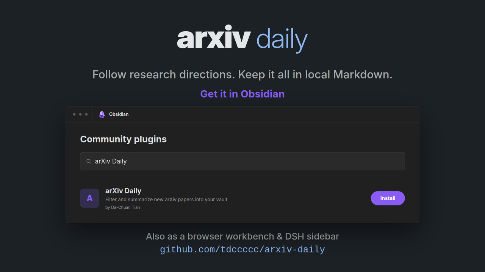

English · [中文说明](docs/README.zh-CN.md)

# arXiv Daily

Follow research directions, filter new arXiv papers, and keep daily reports and detailed paper notes in local Markdown.



**arXiv Daily** is a personal research companion built around the **Obsidian plugin**, with a standalone browser workbench and a DeepSeek Harness (DSH) extension that work without Obsidian.

## Features

- **Filters the flood** — keeps only papers matching the directions inside your research topics
- **Daily report** — up to 20 papers a day by default, grouped by topic, each with a short structured summary
- **Paper notes** — longer per-paper notes on demand, automatic or by arXiv ID
- **Reading views** — Obsidian Dashboard, browser workbench, or DSH sidebar, with calendar, search, topic filters, and favorites
- **Personal library** — optionally index your own PDFs; review and explicitly accept proposed topics and directions before they affect discovery
- **Scheduling** — in Obsidian while it's open, or via CLI/cron on a machine that stays online
- **Optional email** — a short digest after a successful day (your Resend key, or Official delivery Beta)

Reports land in `arxiv-daily/daily/YYYY-MM-DD.md`; paper notes in `arxiv-daily/papers/<arxiv_id>.md`.

## Choose how to use it

| Entry | Best for |
|---|---|
| **Obsidian plugin** | Reading and maintaining research in your vault |
| **CLI + browser workbench** | Terminal use, external scheduling, or a standalone reader without Obsidian |
| **DSH plugin** | The same workbench in a fixed DeepSeek Harness sidebar |

Obsidian and CLI configuration values and API keys do not automatically synchronize; the browser workbench and DSH plugin both reuse the CLI configuration.

## Install

### Obsidian plugin (desktop only)

1. **Community plugins** — Settings → Community plugins → Browse → **arXiv Daily**
2. **BRAT** — add `tdccccc/arxiv-daily`
3. **Manual** — copy `manifest.json`, `main.js`, `styles.css` from the [latest release](https://github.com/tdccccc/arxiv-daily/releases/latest) into `<vault>/.obsidian/plugins/arxiv-daily/`

Enable the plugin, then open **Settings → arXiv Daily**.

### CLI + browser workbench (Node.js 20.19+)

```bash
npm install -g arxiv-daily
arxiv-daily init          # guided setup; Enter keeps defaults
arxiv-daily run --today
arxiv-daily ui            # open the local reading workbench in your browser
```

### DSH plugin (Node.js 22.19+)

```bash
dsh plugin --profile web add dsh-arxiv-daily
```

Restart DSH, then open **arxiv-daily** above Settings in the left sidebar (or the matching right-sidebar tab). DSH Desktop: **Plugins → Add plugin**, enter package name `dsh-arxiv-daily`.

## Quick start

New to arXiv Daily? Walk through [Getting Started](docs/getting-started.md) (中文：[新手教程](docs/getting-started.zh-CN.md)) for the full first-run setup: connecting a model, choosing arXiv categories, describing research topics, and generating your first report.

## Documentation

| Doc | 中文 |
|---|---|
| [Getting Started](docs/getting-started.md) | [新手教程](docs/getting-started.zh-CN.md) |
| [CLI installation and command reference](apps/cli/README.md) | [中文](apps/cli/README.zh-CN.md) |
| [Browser workbench guide](docs/workbench.md) | [中文](docs/workbench.zh-CN.md) |
| [Obsidian plugin](plugin/README.md) | [中文](plugin/README.zh-CN.md) |
| [DSH plugin](extensions/dsh-arxiv-daily/README.md) | [中文](extensions/dsh-arxiv-daily/README.zh-CN.md) |

## Contributing

See [functional and interaction acceptance](scripts/acceptance/README.md) for real browser/desktop checks and optional model API exploration.

## License

MIT — see [LICENSE](LICENSE).
